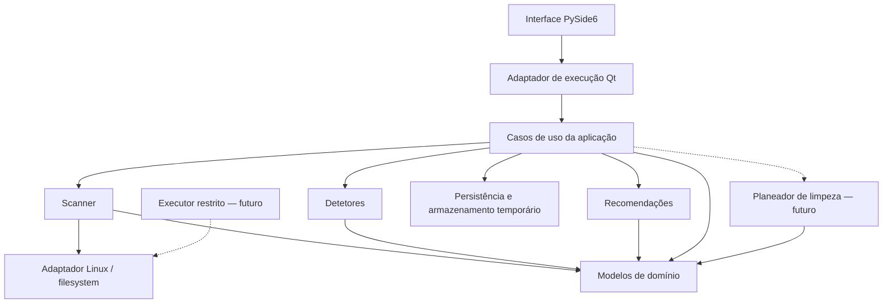
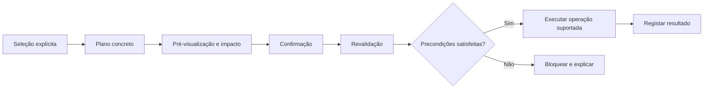

# Diskly — Plano de arquitetura e desenvolvimento

**Estado:** proposta de planeamento; implementação pendente de aprovação explícita.

**Plataforma inicial:** Ubuntu 24.04, x86-64, Python 3.12.

**Recomendação principal:** desenvolver o Diskly como uma aplicação desktop modular em Python e PySide6, com um motor de análise independente da interface. A **v0.1 deve analisar, classificar alguns artefactos e explicar resultados, sem executar limpezas**.

O diferencial deve ser a qualidade das explicações: identificar um diretório como `node_modules` é útil; explicar que contém dependências, pode incluir alterações locais e poderá exigir acesso à Internet para ser reconstruído é o que torna o Diskly mais valioso.

A inspeção inicial do diretório do projeto não revelou código-fonte nem documentação existente. Esta proposta parte, por isso, de uma estrutura nova. Este documento não autoriza o início da implementação.

## 1. Visão geral — Product Vision

### Problema e público-alvo

Os analisadores tradicionais mostram onde está o espaço, mas deixam ao utilizador a interpretação dos resultados e a avaliação das consequências de eliminar ficheiros.

O Diskly destina-se inicialmente a:

- Utilizadores de Ubuntu que precisam de compreender o armazenamento.
- Programadores com projetos, dependências, caches e ferramentas locais.
- Utilizadores menos experientes que precisam de explicações antes de tomar decisões.

A proposta de valor é:

> Mostrar onde está o espaço, explicar a finalidade do conteúdo identificado e apresentar oportunidades de recuperação com consequências e limitações explícitas.

### Pressupostos iniciais

- Ubuntu 24.04, arquitetura x86-64 e Python 3.12 como plataforma de referência.
- Execução com as permissões do utilizador, sem elevação automática.
- Uma análise ativa de cada vez.
- Funcionamento offline, sem telemetria e sem modelos de IA.
- Sistemas de ficheiros locais como âmbito de suporte inicial.
- Resultados baseados numa observação ao longo do tempo, sem garantia de snapshot atómico.
- Interface preparada para tradução; inglês como idioma inicial, acompanhando a documentação do projeto.

### Fronteira da v0.1

A primeira versão deve completar este percurso:

**Selecionar diretório → analisar em background → acompanhar ou cancelar → consultar resultados → compreender alguns artefactos → ler recomendações informativas.**

Histórico persistente, execução de limpezas, duplicados e plugins externos ficam para versões seguintes.

## 2. Arquitetura recomendada — System Architecture

Recomenda-se uma aplicação única, inspirada em arquitetura hexagonal, com poucas fronteiras claras. Não há necessidade de serviços separados, framework de injeção de dependências ou um sistema genérico de eventos.



**Regra central:** os módulos de domínio, análise, classificação e recomendações não importam PySide6.

### Responsabilidades

| Componente | Responsabilidade |
|---|---|
| `domain` | Entidades, estados, métricas, evidências e regras comuns. |
| `application` | Iniciar e cancelar análises, coordenar componentes e consultar resultados. |
| `scanner` | Percorrer o filesystem e produzir medições e ocorrências. |
| `detectors` | Reconhecer artefactos a partir de evidências limitadas. |
| `advisor` | Explicar consequências e classificar oportunidades. |
| `infrastructure` | Acesso ao filesystem Linux, SQLite, configuração e logging. |
| `ui` | Apresentação, navegação, filtros e acessibilidade. |
| Planeador futuro | Converter uma seleção explícita num plano concreto e verificável. |
| Executor futuro | Executar exclusivamente tipos de operação suportados e revalidados. |

As fronteiras justificadas são sobretudo filesystem, armazenamento, emissão de progresso e cancelamento. Funções internas simples não precisam de interfaces próprias.

### Fluxo de dados

1. A interface recolhe o diretório e as opções.
2. A aplicação cria um pedido de análise.
3. Um worker executa o scanner.
4. O scanner produz medições e contexto para os detetores.
5. Os detetores produzem descobertas com evidências.
6. O advisor associa explicações e consequências.
7. A aplicação disponibiliza resumos à interface.
8. O resultado termina como concluído, parcial, cancelado ou falhado.

Os detetores aproveitam a mesma passagem pela árvore: não devem executar uma nova análise recursiva por artefacto.

### Concorrência

Para a v0.1:

- Um `QThreadPool` dedicado, limitado a um worker.
- Um `QRunnable` para a análise completa.
- Um objeto de sinais como adaptador para a interface.
- Cancelamento cooperativo através de um token independente de Qt.
- Atualizações de progresso agregadas, no máximo cerca de cinco por segundo.
- Widgets e modelos Qt modificados exclusivamente na thread principal.

O Qt disponibiliza `QThreadPool` e `QRunnable` para executar tarefas em threads reutilizáveis; a comunicação com a interface precisa de respeitar a afinidade dos objetos. [Documentação de threading do Qt](https://doc.qt.io/qtforpython-6.10/overviews/qtdoc-threads-technologies.html), [Threads and QObjects](https://doc.qt.io/qtforpython-6.10/overviews/qtdoc-threads-qobject.html).

Não criar uma tarefa por ficheiro ou diretório. Isso aumenta a coordenação, a memória e a pressão sobre o disco sem garantir melhor desempenho.

**Limitação:** o cancelamento não interrompe imediatamente uma chamada de I/O bloqueada. Um worker em processo separado pode ser avaliado se o suporte a armazenamento remoto vier a exigir maior isolamento.

## 3. Decomposição detalhada do MVP — MVP Task Breakdown

A implementação deve avançar por pequenas entregas verificáveis, nesta ordem:

| Ordem | Tarefa | Resultado verificável |
|---|---|---|
| 1 | Registar decisões iniciais | Âmbito, métricas de tamanho, política de links e exclusões documentados. |
| 2 | Preparar o projeto | Estrutura `src`, configuração de qualidade, dependências e CI mínimo. |
| 3 | Definir modelos essenciais | Pedidos, estados, contadores, erros e resultados sem dependências Qt. |
| 4 | Criar scanner básico | Percurso incremental e tamanhos corretos numa árvore temporária simples. |
| 5 | Introduzir política de tipos e links | Symlinks não seguidos; ficheiros especiais ignorados; hard links deduplicados nos totais únicos. |
| 6 | Tratar fronteiras e erros | Mount points, permissões, desaparecimentos e limites originam estados explícitos. |
| 7 | Limitar memória | Rankings limitados e armazenamento temporário para índices que crescem. |
| 8 | Acrescentar cancelamento e progresso | Cancelamento cooperativo e eventos agregados sem Qt. |
| 9 | Criar a primeira janela funcional | Seleção de diretório, início, progresso e cancelamento. |
| 10 | Integrar análise em background | Interface utilizável durante a análise; ciclo de vida do worker controlado. |
| 11 | Mostrar resultados | Resumo, maiores ficheiros, maiores diretórios e problemas encontrados. |
| 12 | Implementar três detetores | Maven `target`, Python `.venv` e JavaScript `node_modules`, com contexto. |
| 13 | Acrescentar recomendações informativas | Finalidade, evidência, impacto e risco ou incerteza de cada descoberta. |
| 14 | Completar UX básica | Temas, teclado, mensagens claras, filtros limitados e indicação de cobertura. |
| 15 | Executar validação integrada | Casos de filesystem, testes Qt, benchmarks e regressões. |
| 16 | Preparar a release v0.1.0 | README, instalação, screenshots, limitações e changelog. |

Os testes acompanham cada tarefa; a tarefa 15 reúne a validação do conjunto.

**Primeiro marco funcional:** concluir as tarefas 1–10 permite selecionar um diretório e acompanhar uma análise cancelável. Os detetores entram depois desse percurso estar estável.

## 4. Requisitos funcionais — Functional Requirements

### Incluídos na v0.1

- Selecionar um diretório acessível.
- Executar uma análise sem bloquear a interface.
- Mostrar entradas observadas, bytes contabilizados, duração e problemas.
- Cancelar e consultar resultados parciais.
- Mostrar os 200 maiores ficheiros e os 200 maiores diretórios.
- Distinguir tamanho lógico de alocação reportada pelo filesystem.
- Mostrar categorias básicas e conteúdo não classificado.
- Reconhecer os três artefactos iniciais.
- Explicar finalidade e consequências de uma eventual remoção.
- Mostrar capacidade do filesystem separadamente do tamanho analisado.
- Disponibilizar pesquisa e filtros sobre os resultados retidos.

A pesquisa inicial deve indicar o seu âmbito: **filtrar os maiores resultados não equivale a pesquisar todos os ficheiros analisados**.

### Evolução dos detetores

| Categoria | Evidência proposta | Consequência a explicar | Versão |
|---|---|---|---|
| Maven `target/` | Diretório associado a projeto com `pom.xml` | Pode conter resultados de compilação, relatórios e alterações locais. | v0.1 |
| Python `.venv/` | `pyvenv.cfg` e estrutura compatível | Remove o ambiente e pacotes instalados; reconstrução pode exigir rede. | v0.1 |
| JavaScript `node_modules/` | Contexto com `package.json` | Remove dependências e possíveis alterações locais. | v0.1 |
| Maven `.m2/repository/` | Local conhecido ou configurado e estrutura compatível | Pode conter artefactos locais indisponíveis em repositórios remotos. | v0.2 |
| Gradle `build/` e caches | Contexto Gradle e caminhos reconhecidos | Distinguir resultados de compilação, caches e configuração. | v0.2 |
| Python `__pycache__/` e cache pip | Estrutura, tipos de ficheiro e localização | Regeneração, novos downloads e efeitos no trabalho offline. | v0.2 |
| JavaScript `dist/` | Contexto do projeto e evidências adicionais | Pode conter a única cópia de artefactos publicados. | v0.2 |
| Ollama | Manifests, blobs e localização confirmada | Modelos podem partilhar blobs e exigir downloads grandes. | v0.2 |
| VS Code | Caminhos específicos de caches, extensões e dados | Extensões e dados de trabalho não são equivalentes a cache. | v0.2 |
| Snap | Estado obtido através de integração suportada | Remover revisões pode reduzir opções de rollback. | v0.2 |
| Caches de aplicações | Regras específicas e caminhos XDG | Uma localização de cache não basta para provar segurança. | v0.2 |
| Ficheiros pessoais grandes | Tamanho e classificação superficial | O tamanho não demonstra que sejam dispensáveis. | v0.1, informativo |

Um nome como `build`, `target` ou `dist` é uma pista, não uma prova.

No caso do Ollama, a localização depende da instalação e pode ser alterada por `OLLAMA_MODELS`; não se deve assumir apenas `~/.ollama`. [FAQ oficial do Ollama](https://docs.ollama.com/faq#where-are-models-stored).

No Snap, identificar revisões deve basear-se no estado do gestor, sem apagar diretamente o conteúdo gerido por ele. [Documentação de revisões Snap](https://snapcraft.io/docs/revisions/).

### Plugins

Na v0.1, usar um registo explícito de detetores internos.

Depois de estabilizar o contrato, considerar descoberta por entry points Python. Esta é uma abordagem suportada pelo ecossistema de packaging, mas um plugin instalado executa código com as permissões da aplicação. [Guia de plugins da PyPA](https://packaging.python.org/en/latest/guides/creating-and-discovering-plugins/).

Não carregar código, plugins ou regras executáveis encontrados dentro dos diretórios analisados.

## 5. Requisitos não funcionais — Non-Functional Requirements

| Área | Requisito proposto |
|---|---|
| Segurança | A v0.1 não altera nem elimina os conteúdos analisados. |
| Desempenho | Percurso incremental; sem leitura integral do conteúdo dos ficheiros. |
| Memória | Sem uma lista ou objeto Python permanente por ficheiro. |
| Responsividade | A interface continua a aceitar navegação e cancelamento. |
| Precisão | Métricas, exclusões e cobertura sempre identificadas. |
| Robustez | Um erro numa entrada não invalida automaticamente toda a análise. |
| Privacidade | Sem telemetria, uploads ou caminhos completos em logs por defeito. |
| Portabilidade | Núcleo separado das integrações Linux; suporte declarado inicialmente apenas para Ubuntu 24.04. |
| Usabilidade | Mensagens acionáveis, unidades consistentes e risco comunicado por texto. |
| Manutenibilidade | Contratos pequenos, dependências limitadas e testes sem Qt para o núcleo. |

### Metas iniciais de validação

Propõem-se estas metas, a confirmar num equipamento de referência documentado:

- Feedback visual ao iniciar ou cancelar em até 200 ms.
- Cancelamento concluído em até um segundo em I/O local sem chamadas bloqueadas.
- Benchmark de 100 mil entradas sem bloqueios visíveis da interface.
- Ensaio de um milhão de entradas com RSS total alvo até 300 MiB.
- Comparação de desempenho com um percurso de referência que recolha os mesmos metadados.

São **metas de aceitação propostas**, não resultados já medidos. Tempos absolutos de análise só devem ser fixados depois de caracterizar hardware, filesystem e estrutura dos dados.

## 6. Decisões tecnológicas — Technology Decisions

| Tecnologia | Decisão e justificação |
|---|---|
| Python 3.12 | Base inicial alinhada com a plataforma escolhida. Evita depender de funcionalidades mais recentes sem necessidade. |
| PySide6 | Adequado para desktop Linux e integração com Qt. |
| Qt Widgets | Preferido na v0.1: tabelas, modelos, teclado e acessibilidade com menor esforço inicial. |
| QML | Reavaliar apenas se a experiência visual justificar uma segunda camada tecnológica. |
| `os.scandir` e `os.stat` | Base do percurso e recolha explícita de metadados. |
| `pathlib` | Útil para configuração e apresentação; evitar conversões excessivas no percurso crítico. |
| SQLite via `sqlite3` | Índices temporários e, posteriormente, snapshots persistentes sem servidor adicional. |
| `QThreadPool` / `QRunnable` | Um worker dedicado para a análise inicial. |
| Componentes Qt | Tabelas e barras simples; gráficos complexos não são necessários para validar o produto. |
| PyQtGraph | Adiar até existirem tendências ou visualizações que beneficiem dele. |
| pytest e pytest-qt | Separação entre testes do núcleo e integração gráfica. |
| Ruff | Linting e formatação. |
| mypy | Verificação de tipos, começando pelos contratos e núcleo. |
| pre-commit | Feedback local; as mesmas verificações executadas no CI. |

O `sqlite3` da biblioteca padrão é suficiente para este tipo de armazenamento local; não há vantagem inicial em introduzir um ORM. [Documentação de sqlite3](https://docs.python.org/3.12/library/sqlite3.html).

### Distribuição

- **v0.1:** instalação documentada num ambiente virtual.
- **v0.2:** protótipo de empacotamento para detetar cedo problemas com Qt e bibliotecas nativas.
- **v1.0:** pelo menos um formato distribuível e testado.

A preferência inicial é priorizar `.deb`, dado o foco em Ubuntu. AppImage será útil se a distribuição entre várias distribuições passar a ser um requisito.

AppImage exige atenção às bibliotecas incluídas e ao sistema usado para construir o pacote; não elimina testes de compatibilidade. [Conceitos oficiais do AppImage](https://docs.appimage.org/introduction/concepts.html).

`pyside6-deploy` é uma opção a avaliar para produzir o executável, distinta da decisão sobre o formato de distribuição. [Deployment do Qt for Python](https://doc.qt.io/qtforpython-6/deployment/deployment-pyside6-deploy.html).

## 7. Estrutura proposta — Project Structure

A árvore seguinte é uma proposta documental. A criação de `plan.md` não implica criar os restantes ficheiros.

```text
diskly/
├── plan.md
├── pyproject.toml
├── README.md
├── LICENSE
├── CONTRIBUTING.md
├── CHANGELOG.md
├── SECURITY.md
├── .pre-commit-config.yaml
├── .github/
│   ├── workflows/
│   │   ├── ci.yml
│   │   └── release.yml
│   └── ISSUE_TEMPLATE/
├── src/
│   └── diskly/
│       ├── __main__.py
│       ├── bootstrap.py
│       ├── domain/
│       ├── application/
│       ├── scanner/
│       ├── detectors/
│       ├── advisor/
│       ├── infrastructure/
│       │   ├── linux/
│       │   └── persistence/
│       └── ui/
├── tests/
│   ├── unit/
│   ├── integration/
│   ├── ui/
│   └── fixtures/
├── benchmarks/
├── docs/
│   ├── architecture.md
│   ├── installation.md
│   ├── development.md
│   ├── safety.md
│   ├── limitations.md
│   ├── detectors.md
│   └── adr/
└── assets/
```

Criar apenas os módulos com comportamento real. As pastas de planeamento e execução de limpeza entram quando forem necessárias.

### Preparação para open-source e portefólio

O README em inglês deve incluir:

- Problema resolvido e público-alvo.
- Screenshot e demonstração curta.
- Instalação e primeiro percurso de utilização.
- Funcionalidades disponíveis na versão publicada.
- Limitações de medição e cobertura.
- Indicação explícita de que a v0.1 não executa limpezas.
- Instruções para contribuir e reportar problemas.

Recomenda-se **MIT para o código próprio**, se o objetivo for facilitar reutilização. A distribuição tem de respeitar separadamente as licenças das dependências e módulos Qt utilizados; alguns módulos Qt têm condições diferentes. [Licenciamento oficial do Qt](https://www.qt.io/development/open-source-lgpl-obligations).

O `SECURITY.md` deve definir um canal privado de reporte e pedir exemplos mínimos com nomes e caminhos anonimizados.

## 8. Modelo de domínio — Domain Model

| Entidade | Informação principal |
|---|---|
| `ScanRequest` | Raiz, exclusões, política de mounts, limites e opções. |
| `ScanSession` | Identificador, estado, início, fim e versões das regras. |
| `EntryObservation` | Tipo, identidade, tamanhos e metadados observados; normalmente transitória. |
| `FileIdentity` | Dispositivo e inode, com metadados adicionais para detetar alterações. |
| `DirectorySummary` | Contadores, métricas e cobertura de um diretório. |
| `ArtifactFinding` | Categoria, localização, detetor, evidências e confiança. |
| `Recommendation` | Finalidade, consequências, risco e limitações da estimativa. |
| `ScanIssue` | Tipo de problema, âmbito afetado e possibilidade de continuar. |
| `ScanResult` | Totais, rankings, categorias, descobertas e qualidade. |
| `Snapshot` | Resumo persistente e política de retenção; futuro. |
| `CleanupPlan` | Operações concretas, precondições e confirmação; futuro. |
| `OperationRecord` | Estado e resultado de execução; futuro. |

### Contratos essenciais

- **Scanner:** recebe pedido, token de cancelamento e destino de eventos.
- **Detetor:** recebe contexto limitado e devolve descobertas fundamentadas.
- **Advisor:** transforma descobertas em explicações e oportunidades.
- **Armazenamento:** grava e consulta resumos sem expor SQLite ao domínio.
- **Adaptador Linux:** encapsula metadados, mounts e capacidades específicas.

O contrato dos detetores não lhes concede capacidade de modificar ficheiros nem executar comandos.

### Estados e qualidade

Estados da análise:

`queued → running → completed | partial | cancelled | failed`

A qualidade deve ser modelada separadamente:

- Entradas inacessíveis.
- Subárvores ignoradas.
- Mudanças observadas.
- Limites atingidos.
- Métricas indisponíveis.
- Cobertura incompleta.

Uma análise concluída significa que terminou o percurso previsto; não significa que o filesystem permaneceu imóvel.

### Risco e confiança

São conceitos distintos:

- **Confiança:** qualidade das evidências de identificação.
- **Risco:** consequências da operação considerada.
- **Elegibilidade:** possibilidade de cumprir as precondições para executar.

É possível identificar uma `.venv` com elevada confiança e continuar sem condições para recomendar a sua remoção como segura.

## 9. Modelo de dados — Data Model

### v0.1: armazenamento temporário

SQLite pode servir de apoio à análise sem introduzir histórico visível:

| Estrutura temporária | Finalidade |
|---|---|
| Diretórios | Relação pai-filho, métricas e agregação. |
| Identidades de diretórios visitados | Deteção de revisitas e ciclos. |
| Inodes com múltiplos links | Deduplicação e contexto de partilha. |
| Descobertas | Resultados dos detetores sem acumulação ilimitada em RAM. |
| Problemas agregados | Contagens e amostra limitada de detalhes. |

Os ficheiros normais são processados incrementalmente. Não é necessário guardar uma linha para cada ficheiro.

Os rankings mantêm apenas os maiores resultados. Consultas grandes à base temporária devem ser paginadas e executadas fora da thread gráfica.

### v0.3: snapshots persistentes

| Tabela | Campos essenciais |
|---|---|
| `scan_snapshot` | ID, raiz, datas, estado, versões, métricas totais e cobertura. |
| `scan_policy` | Exclusões, política de mounts, limites e modo de medição. |
| `filesystem_summary` | Tipo, identificadores disponíveis e capacidade observada. |
| `directory_summary` | Caminho relativo, profundidade, métricas, contadores e cobertura. |
| `category_summary` | Categoria, métrica e bytes atribuídos. |
| `artifact_summary` | Detetor, versão, categoria, caminho, tamanho e evidências limitadas. |
| `issue_summary` | Código, quantidade e amostra limitada. |
| `schema_migration` | Versão do esquema. |

Na v0.4, acrescentar `cleanup_plan`, `cleanup_operation` e `operation_event`.

### Retenção e comparabilidade

Proposta inicial:

- Guardar totais completos.
- Guardar diretórios até profundidade três, sujeitos a um limite documentado.
- Reter os maiores consumidores e artefactos relevantes.
- Não guardar permanentemente o inventário completo de ficheiros.
- Conservar, por defeito, 30 snapshots por raiz.
- Permitir eliminar o histórico pela interface.

A ausência de um caminho num snapshot resumido significa **“não retido”**, não “tamanho zero”. Comparações exatas devem restringir-se a caminhos com cobertura compatível.

Raiz, políticas, métrica e versão das regras têm de acompanhar cada snapshot. Uma alteração de exclusões não deve aparecer como crescimento ou redução real.

### Operação da base

- Transações em lotes.
- Migrações pequenas e versionadas.
- Índices por snapshot e caminho.
- Ligação SQLite pertencente à thread que a utiliza.
- Limites de espaço para o armazenamento temporário.
- Recuperação de sessões interrompidas no arranque.

Não ativar WAL por rotina: na v0.1 um único escritor pode usar o modo convencional. Reavaliar WAL com leituras concorrentes do histórico, mantendo a base em armazenamento local. [Documentação SQLite sobre WAL](https://www.sqlite.org/wal.html).

## 10. Algoritmo de análise — Scanning Algorithm

### Estratégia

1. Validar a raiz e confirmar a sua identidade.
2. Recolher o contexto do filesystem e das montagens.
3. Excluir o armazenamento interno do próprio Diskly.
4. Percorrer a árvore iterativamente, sem recursão Python.
5. Consumir cada iterador `scandir` incrementalmente.
6. Recolher metadados sem seguir symlinks.
7. Aplicar as políticas de entrada e montagem.
8. Atualizar métricas, rankings e contexto dos detetores.
9. Agregar diretórios quando a respetiva subárvore termina.
10. Verificar cancelamento entre operações e lotes.
11. Fechar recursos e produzir o resultado com a sua cobertura.

Sempre que aplicável, usar acesso relativo a descritores e abertura de diretórios sem seguir symlinks, reduzindo a dependência de resolver repetidamente caminhos mutáveis.

`scandir` é adequado ao percurso incremental, mas os dados de `DirEntry` podem estar em cache. Uma validação posterior exige uma nova observação. [Documentação Python de filesystem](https://docs.python.org/3.12/library/os.html).

### Métricas de tamanho

O Diskly deve distinguir:

| Métrica | Significado |
|---|---|
| Tamanho lógico | Comprimento do ficheiro, normalmente `st_size`. |
| Alocação reportada | `st_blocks × 512`, quando disponível. |
| Espaço potencialmente recuperável | Estimativa dependente dos links, filesystem, operação e contexto. |

`st_blksize` não é o multiplicador de `st_blocks`. Ficheiros esparsos podem ter tamanho lógico muito superior à alocação reportada. [Definição de `st_blocks`](https://docs.python.org/3.12/library/os.html#os.stat_result.st_blocks).

A alocação reportada não representa necessariamente espaço físico exclusivo em filesystems com compressão, reflinks, snapshots ou deduplicação.

### Hard links e totais

- Deduplicar os totais globais únicos por `(st_dev, st_ino)`.
- Manter índices específicos para ficheiros com múltiplos links.
- Mostrar que métricas por caminho ou subárvore podem incluir referências ao mesmo conteúdo.
- Não somar rankings de diretórios sobrepostos.
- Separar conteúdo partilhado quando necessário para produzir categorias aditivas.
- Não confundir a presença de um link com a possibilidade de libertar os blocos.

Para a v0.1, os rankings de diretórios podem usar **tamanho lógico aparente por subárvore**, identificado como tal. Os totais únicos globais são apresentados separadamente.

### Memória e limites

- Rankings limitados, sem ordenação de todos os ficheiros em RAM.
- Índices de diretórios e hard links apoiados em SQLite temporário.
- Eventos de progresso agregados.
- Amostras de erros com tamanho limitado.
- Limite explícito de profundidade ou descritores abertos.
- Orçamento para armazenamento temporário.

Se um limite impedir continuar, o resultado é parcial e identifica a parte omitida. Não apresentar totais truncados como completos.

### Symlinks, mounts e entradas especiais

- Não seguir symlinks por defeito.
- Contabilizar o link separadamente, sem percorrer o destino.
- Não atravessar montagens descendentes por defeito.
- Combinar identidade do dispositivo com informação de montagens.
- Não depender apenas de `st_dev`: bind mounts podem manter o dispositivo.
- Não abrir FIFOs, sockets ou dispositivos para ler conteúdo.

`/proc/self/mountinfo` fornece informação de montagens, incluindo relações relevantes para bind mounts. [Manual de mountinfo](https://man7.org/linux/man-pages/man5/proc_pid_mountinfo.5.html).

### Alterações durante a análise

Ficheiros podem mudar ou desaparecer entre observações. O scanner deve continuar quando possível e registar o problema.

Não existe uma garantia de consistência global apenas por usar `stat`; até os seus campos podem refletir instantes diferentes durante alterações concorrentes. [Manual de stat](https://man7.org/linux/man-pages/man2/stat.2.html).

### Progresso

Sem uma passagem prévia, o número final de entradas é desconhecido. Mostrar:

- Entradas observadas.
- Bytes contabilizados.
- Diretório atual.
- Tempo decorrido.
- Problemas encontrados.
- Fase atual.

Usar progresso indeterminado durante o percurso. Evitar percentagens que transmitam precisão inexistente.

## 11. Modelo de segurança — Safety Model

### Política da v0.1

**O Diskly apresenta informação e recomendações; não possui um executor de limpeza.**

Não deve:

- Executar scripts dos projetos.
- Importar módulos encontrados durante a análise.
- Interpretar nomes de ficheiros como comandos.
- Ler configurações sem limites.
- Pedir privilégios elevados automaticamente.

As leituras necessárias podem afetar metadados de acesso conforme o filesystem; “análise sem alterações” refere-se a não modificar deliberadamente o conteúdo analisado.

### Classificação de risco

| Nível | Critério |
|---|---|
| Baixo | Conteúdo comprovadamente regenerável, contexto conhecido e precondições de utilização satisfeitas. |
| Médio | Remoção recuperável, mas com custos, perda de estado local ou dependência de rede. |
| Elevado | Dados pessoais, bases de dados, configurações, dados persistentes ou sistema. |
| Não determinado | Evidência insuficiente; nunca apresentado como seguro. |

Uma `.venv` ou `node_modules` deve começar como risco médio, acompanhado de condições. A idade, o nome ou a possibilidade teórica de reconstrução não justificam automaticamente risco baixo.

A inexistência de ficheiros abertos numa verificação pontual também não prova ausência de utilização futura. Para operações de baixo risco, poderão ser necessárias integrações com quiescência ou coordenação suportada pela aplicação responsável.

### Espaço recuperável

A v0.1 deve usar expressões como **“espaço associado a possíveis candidatos”**, sem prometer libertação.

A estimativa deve:

- Evitar sobreposição entre candidatos.
- Descontar ou excluir hard links sem informação suficiente.
- Excluir subárvores incompletas.
- Indicar incerteza em armazenamento partilhado.
- Separar “não calculável” de zero bytes.

Mesmo após remover o último nome de um ficheiro, o espaço pode continuar ocupado enquanto um processo mantiver o ficheiro aberto. [Manual de unlink](https://man7.org/linux/man-pages/man2/unlink.2.html).

### Limpeza futura: sequência obrigatória



A confirmação aplica-se a um plano concreto. Se os alvos ou as operações mudarem materialmente, o plano deixa de estar aprovado.

### Corridas e symlink attacks

Na v0.4:

- Restringir tipos de operação e raízes elegíveis.
- Revalidar identidade, tipo, proprietário e metadados relevantes.
- Usar descritores e operações relativas a diretórios.
- Rejeitar componentes simbólicos e travessias inesperadas.
- Não aceitar uma comparação textual de prefixos como contenção.
- Não usar `resolve → stat → delete` como garantia de segurança.

`openat2` disponibiliza restrições de resolução como `RESOLVE_BENEATH` e `RESOLVE_NO_SYMLINKS`, úteis numa implementação Linux especializada. [Manual de openat2](https://man7.org/linux/man-pages/man2/openat2.2.html).

Contudo, **uma verificação seguida de `unlink` não elimina por si só todas as corridas sobre nomes**. Operações em diretórios que outros processos possam substituir exigem desenho e testes específicos; quando não houver garantia suficiente, a operação deve ficar indisponível.

Não prometer proteção absoluta contra um processo malicioso com o mesmo utilizador e acesso aos dados da aplicação.

### Reversibilidade e falhas

Mover para o lixo é preferível quando suportado, mas normalmente não liberta espaço no mesmo filesystem. A interface deve distinguir movimentação reversível de eliminação definitiva. [Especificação Freedesktop Trash](https://specifications.freedesktop.org/trash/latest/).

Para execução futura:

- Registar intenção antes da operação.
- Registar resultado por item.
- Não assumir atomicidade entre SQLite e filesystem.
- Após falha, reconciliar estados antes de repetir.
- Não repetir operações destrutivas cegamente.
- Não substituir ficheiros numa tentativa de restauro.
- Reportar sucesso parcial.

Não deve existir fallback silencioso do lixo para eliminação definitiva.

### Privacidade e logging

- Logs com IDs, duração, contagens e códigos de erro.
- Caminhos completos apenas em diagnóstico explicitamente ativado.
- Rotação e retenção limitada.
- Dados locais com permissões restritas ao utilizador.
- Caminhos tratados como texto não confiável na interface.
- Caracteres de controlo escapados e nomes Linux não decodificáveis tratados sem falha.
- Nenhum envio automático de relatórios.

O SQLite não fornece encriptação por defeito; não apresentar a base como encriptada.

## 12. Interface — UI/UX Plan

### Ecrã inicial

- Selecionar diretório.
- Mostrar âmbito e exclusões principais.
- Explicar o comportamento perante symlinks e mounts.
- Botão “Analisar”.

### Durante a análise

- Contadores e tempo.
- Diretório atual.
- Progresso indeterminado.
- Botão “Cancelar”.
- Contagem de problemas sem interrupções modais repetidas.

### Resultados

Quatro áreas principais:

1. **Resumo:** tamanho analisado, cobertura e capacidade do filesystem.
2. **Maiores consumidores:** tabelas ordenáveis.
3. **Categorias:** distribuição simples com conteúdo desconhecido visível.
4. **Artefactos e recomendações:** finalidade, evidência, impacto e risco.

Os detalhes devem mostrar:

- Caminho e tipo.
- Tamanho lógico e alocação disponível.
- Identificação do detetor.
- Evidências e confiança.
- Limitações da medição.
- Consequências de eventual remoção.

### Estados da interface

Prever explicitamente:

- Diretório vazio.
- Raiz inacessível.
- Análise parcial.
- Cancelamento em curso.
- Resultado cancelado.
- Falha fatal.
- Espaço temporário insuficiente.
- Métrica indisponível.
- Nenhum artefacto reconhecido.

### Acessibilidade e apresentação

- Tema claro, escuro e preferência do sistema.
- Navegação completa por teclado.
- Foco visível e etiquetas acessíveis.
- Contraste adequado e escalabilidade de texto.
- Risco indicado por texto e ícone, além da cor.
- Unidades consistentes, por exemplo MiB/GiB.

Não colocar um botão de limpeza inativo na v0.1: a interface deve corresponder às capacidades publicadas.

A capacidade do volume e o tamanho do diretório selecionado devem ter rótulos distintos. A diferença pode incluir outros diretórios, dados inacessíveis, reservas, snapshots e ficheiros eliminados ainda abertos.

## 13. Testes — Testing Strategy

### Núcleo e filesystem

| Grupo | Casos essenciais |
|---|---|
| Percurso | Árvore vazia, ficheiros pequenos, profundidade e diretório muito largo. |
| Tamanhos | Ficheiros vazios, grandes, esparsos e métricas indisponíveis. |
| Symlinks | Destinos internos, externos, inexistentes e ciclos. |
| Hard links | Mesma pasta, pastas distintas e links fora da raiz. |
| Permissões | Falha na raiz e em subdiretórios. |
| Concorrência | Criação, remoção, alteração e substituição de entradas. |
| Cancelamento | Antes de iniciar, durante percurso e durante agregação. |
| Limites | Rankings, erros, profundidade e espaço temporário. |
| Entradas especiais | FIFOs e sockets sem bloqueio por abertura. |
| Nomes | Unicode, caracteres de controlo e bytes não decodificáveis. |
| Detetores | Evidência suficiente, ambiguidade e falsos positivos. |
| Advisor | Risco conservador, informação insuficiente e candidatos sobrepostos. |

Testes de permissões devem correr como utilizador sem privilégios. Um simples `chmod` pode não produzir o resultado esperado quando o teste corre como root.

Montagens reais e filesystems especiais podem exigir ambientes isolados próprios. O CI normal deve testar também o parsing e as políticas através de adaptadores simulados.

### Interface

Com pytest-qt:

- Iniciar e cancelar.
- Receber eventos sem acesso indevido a widgets.
- Ignorar eventos atrasados de outra sessão.
- Mostrar resultados parciais e falhas.
- Aplicar filtros.
- Encerrar durante uma análise.
- Verificar teclado e estados de foco essenciais.

### Benchmarks

Usar árvores sintéticas com:

- Muitos ficheiros pequenos.
- Muitos diretórios.
- Um diretório com um milhão de entradas.
- Árvores profundas.
- Muitos hard links.
- I/O artificialmente lento.

Medir duração, entradas por segundo, RSS máximo, dimensão da base temporária, atraso da interface e latência de cancelamento.

Documentar hardware, filesystem e condições de cache. Não comparar medições com trabalhos diferentes como se fossem equivalentes.

### Regressões e segurança

- Preservar casos mínimos que reproduzam bugs.
- Validar que a análise não modifica conteúdos.
- Verificar fecho de descritores e recursos.
- Testar ausência de comandos provenientes de nomes ou metadados.
- Acrescentar testes adversariais de execução apenas quando existir executor.

Todos os testes destrutivos futuros ficam restritos a árvores descartáveis criadas pelo teste. Nunca usar diretórios pessoais ou do sistema como alvo.

## 14. Evolução — Development Roadmap

A sequência proposta mantém as versões pedidas. A única clarificação é que a v0.1 já inclui três detetores simples; a v0.2 expande o sistema de classificação.

| Versão | Funcionalidades | Dependências | Risco principal | Aceitação e testes |
|---|---|---|---|---|
| **v0.1** | Scanner, cancelamento, rankings, GUI, três detetores e explicações. | Políticas de medição e contratos básicos. | Contagens erradas, memória e bloqueios. | Definition of Done abaixo; testes do scanner, Qt e benchmarks. |
| **v0.2** | Catálogo alargado, evidências, recomendações mais completas e protótipo de distribuição. | Métricas e fluxo estáveis. | Falsos positivos e classificação de risco otimista. | Cada regra tem documentação, casos positivos, negativos e ambíguos. |
| **v0.3** | Snapshots, retenção e comparação. Tendências simples quando comparáveis. | Políticas e métricas versionadas. | Comparações enganosas por cobertura diferente. | Migrações, retenção, sessões interrompidas e comparação de subárvores completas. |
| **v0.4** | Planeamento e execução de operações restritas. | Modelo de segurança revisto e integrações específicas. | Perda de dados e corridas. | Pré-visualização, confirmação, revalidação, histórico e testes de falha/adversariais. |
| **v0.5** | Pesquisa de duplicados e revisão manual. | Identidade e medição robustas; controlo de I/O. | Confundir equivalência de conteúdo com segurança de remoção. | Hashes, mutações, hard links, limites e estimativa conservadora. |
| **v1.0** | Estabilização, documentação completa e distribuição validada. | Funcionalidades publicadas suficientemente maduras. | Combinações pouco testadas e manutenção. | Instalação limpa, matriz de suporte, regressões, acessibilidade e revisão de segurança. |

A v0.4 não deve estrear um eliminador recursivo genérico. Deve começar por poucas operações com precondições verificáveis. As restantes continuam informativas.

Alertas, deteção de crescimento anómalo e monitorização contínua entram depois de existir histórico comparável suficiente.

### Duplicate Finder

Estratégia futura:

1. Considerar ficheiros regulares elegíveis.
2. Agrupar por tamanho lógico.
3. Separar hard links, que não são cópias independentes.
4. Usar hashes parciais opcionais para reduzir candidatos.
5. Calcular hashes completos por blocos.
6. Confirmar igualdade byte a byte antes de qualquer operação.
7. Detetar alterações durante a comparação.
8. Exigir revisão manual.

O hash parcial serve apenas como filtro. Conteúdo igual não significa que qualquer cópia seja dispensável para as aplicações que a referenciam.

### CI, versões e releases

GitHub Actions deve executar:

- Ruff e verificação de tipos.
- Testes do núcleo.
- Testes Qt em ambiente gráfico virtual.
- Construção do pacote.
- Smoke test de instalação.
- Benchmarks maiores em execução separada.

Começar com Python 3.12 e Ubuntu 24.04; alargar a matriz apenas quando o suporte for assumido.

Usar versões `v0.1.0`, `v0.1.1` e seguintes, changelog por release e notas explícitas sobre alterações de regras ou métricas. Antes da v1.0, comunicar claramente mudanças incompatíveis. [Semantic Versioning](https://semver.org/spec/v2.0.0.html).

As releases devem incluir fontes, artefactos disponíveis, checksums, instruções, limitações e capturas feitas com dados fictícios.

## 15. Riscos e compromissos — Risks and Trade-offs

| Decisão ou risco | Consequência | Resposta proposta |
|---|---|---|
| Um worker inicial | Pode não maximizar desempenho em todos os discos. | Medir antes de paralelizar. |
| Sem inventário permanente de ficheiros | Pesquisa e histórico menos detalhados. | Explicitar cobertura e reanalisar quando necessário. |
| SQLite temporário | Consome espaço enquanto analisa. | Limites, transações em lotes e estado parcial em falha. |
| Filesystem mutável | Totais podem refletir momentos diferentes. | Documentar observação não atómica e detetar mudanças observáveis. |
| Hard links e reflinks | Bytes atribuídos não equivalem a bytes libertáveis. | Separar métricas e excluir estimativas inseguras. |
| Rede e FUSE | I/O pode bloquear e o cancelamento atrasar. | Excluir do suporte inicial; avaliar isolamento futuro. |
| Reconhecimento por convenções | Projetos personalizados podem não ser reconhecidos. | Evidências explícitas e categoria desconhecida. |
| Reconstrução dependente de rede | Artefactos regeneráveis podem ser essenciais offline. | Mostrar esse custo nas recomendações. |
| Dados geridos por aplicações | Remoção direta pode corromper estado. | Preferir integração suportada pelo gestor. |
| Qt e empacotamento | Artefactos maiores e dependências nativas. | Prototipar distribuição cedo e testar em sistema limpo. |
| Plugins externos | Executam código com acesso do utilizador. | Adiar, exigir instalação explícita e documentar confiança. |
| Limpeza reversível | Pode não recuperar espaço imediato. | Mostrar reversibilidade e recuperação como propriedades distintas. |

A principal escolha de produto é aceitar que o Diskly diga **“não consigo determinar a segurança”**. Essa resposta é preferível a apresentar uma heurística como garantia.

## 16. Critérios de conclusão — Definition of Done da v0.1

A v0.1 está concluída quando:

- [ ] Instala e inicia no Ubuntu 24.04 pelo procedimento documentado.
- [ ] Analisa um diretório selecionado sem bloquear a interface.
- [ ] Mostra progresso sem percentagens enganadoras.
- [ ] Permite cancelar e identifica os resultados parciais.
- [ ] Não segue symlinks nem atravessa mounts descendentes por defeito.
- [ ] Deduplica hard links nos totais únicos globais.
- [ ] Distingue tamanho lógico, alocação reportada e espaço potencialmente recuperável.
- [ ] Identifica permissões insuficientes, entradas desaparecidas e limites atingidos.
- [ ] Apresenta os maiores ficheiros e diretórios com métricas e âmbito claros.
- [ ] Reconhece `target`, `.venv` e `node_modules` com evidências contextuais.
- [ ] Explica finalidade e consequências sem classificar incerteza como segurança.
- [ ] Não inclui qualquer execução de limpeza.
- [ ] Não acumula em RAM todos os ficheiros analisados.
- [ ] Cumpre as metas de desempenho acordadas no equipamento de referência.
- [ ] Passa linting, verificação de tipos e testes relevantes no CI.
- [ ] Funciona offline durante a utilização.
- [ ] Disponibiliza temas e navegação básica por teclado.
- [ ] Tem README em inglês, instalação, arquitetura, limitações e guia de desenvolvimento.
- [ ] Tem licença, changelog, política de segurança e release identificada.
- [ ] Inclui screenshots e demonstração com dados não pessoais.

**O início da implementação depende de aprovação explícita deste plano.**
